# Build the Review Screens (Block 3f)

Everything so far runs invisibly; the only view is the traces of case instances. This block builds the part of your solution that humans will *see* and use: the **Coded Action App**'s two screens, the **Eligibility Review** and the **Claim Review**, that the **Maestro Case** raises its tasks against in **Action Center**.

Screens come last for a reason: by now your own runs have populated real records, so the screens are built against **payloads your own Agents actually produced**. The agent captures fixtures from your Data Fabric records.

## Decided for us

- **What exactly the reviewer must see.** `PDD.md` §5.7 lists it: the stages, every check including the passes, the settlement line by line, the three documents, two outcomes with a written reason.
- **The layout.** `3f-validation/layout.md` fixes the regions of both screens, so every seat's screen is reviewable against one expectation.
- **The look.** `3f-validation/brand.md` carries the palette, type and CSS tokens.
- **The rest is yours**, and you have to state it to your agent explicitly. Asked for "a screen that shows a claim," an agent produces a correct form generated from a schema. **Taste is a requirement you have to state**: what is visible before scrolling, what opens on demand, how the width is used. Everything else in a spec is checkable; this one it will silently skip.

## The prompt

````markdown title="Prompt — block 3f · Action App"
--8<-- "seeds/3f-validation/prompt.md"
````

Steps:

- [x] Read `PDD.md` §5.7, `contracts/review-task.md`, `3f-validation/layout.md` and `brand.md`; load the uipath-coded-apps skill
- [x] Capture fixtures from the seat's own live records (the decided states verbatim, the waiting states rewound to the columns that exist at that gate), plus the real PDFs for the document overlay; capture each open-gate fixture while its task is still open
- [x] Derive the status→stage map from `caseplan.case` (a stage list typed into the app is forbidden; generate it)
- [x] Build the two gate screens into the app registered at 3d: same name, same schema, contract untouched
- [x] Serve locally inside an Action Center stand-in and pause: the reviewer walks the four states
- [x] Apply the feedback; prove the shipped bundle carries no dev fixtures; pack → `publish -t Action` → deploy the app alone
- [x] Prove write-back per gateway: fresh claim, task completed from the CLI, record read back
- [x] Update `PROGRESS.md`

## The localhost review (by you)

Coded Apps can be served locally and previewed before publishing to Orchestrator. Every screen fix after a deploy costs a pack → publish → deploy cycle; the same fix on a localhost preview costs a refresh. So the coding agent is instructed to pause **before its first publish**, with the app served locally on your captured fixtures, while you review four states:

| Open                                        | What to check                                                                                               |
| ------------------------------------------- | ----------------------------------------------------------------------------------------------------------- |
| `http://127.0.0.1:<port>/?gate=eligibility` | All five checks visible with results and reasons, passes included; the claim recognizable                   |
| `…?gate=eligibility&state=decided`          | A decided task still identifies its claim and shows the decision that survived                              |
| `…?gate=review`                             | Every finding side by side, the recommendation with its reasons, the settlement line by line, the documents |
| `…?gate=review&state=decided`               | The confirmed figures carrying a real settlement override, not just the recommended numbers                 |

!!! tip "Be there when it pauses"
    This review needs a person at a browser, and the agent waits for you. Plan for it: know roughly when block 3f reaches its pause, and if someone else reviews for you (a colleague, the instructor), book them for that moment. An agent with no browser of its own cannot open the stand-in for you: it hands over the four URLs, the port it served on, and what each state should show, and waits for your answer. Tell it what you saw in plain words; *"approved"* is an answer too.

Reading is half of it; **use the controls too**, because the stand-in runs the same form code the deployed app will:

- **Every PDF opens** in the document view: the claim form, the policy and the assessor report, each with a readable first page, not a blank frame
- **A decision needs a reason**: press an outcome with the reason empty and the screen refuses it and says why (the buttons stay enabled on purpose, so keyboards and screen readers reach them); the reason can be edited after you type it
- **Settlement lines are adjustable on the claim review**: change one line down and one up, see the total follow, and see a change without its own reason refused; a line raised above the higher of the claimed amount and the assessor's estimate is refused too (`PDD.md` BR-61)
- **The eligibility review edits nothing**: its five checks are read-only, only the outcome and the reason are yours

The stand-in's buttons send nothing anywhere: *Show messages* displays the payload a decision would send, so check that it carries your outcome, your reason and any changed lines.

Hand what you find back to the agent, let it fix, refresh, and approve. **Then** it publishes once. Your iteration loop has layers: 

- A label or layout change needs only a browser reload
- An analysis change needs a case instance restart
- A data-structure or code change needs new fixtures and a rebuild or redeploy

Iterate on the **cheapest layer** and never let the cheap loop be the last thing you ran.

Here is that review from a real run: the four states, served on the local Action Center stand-in. The banner marks a local fixture, captured from the seat's own records and never shipped:

=== "eligibility · open"

    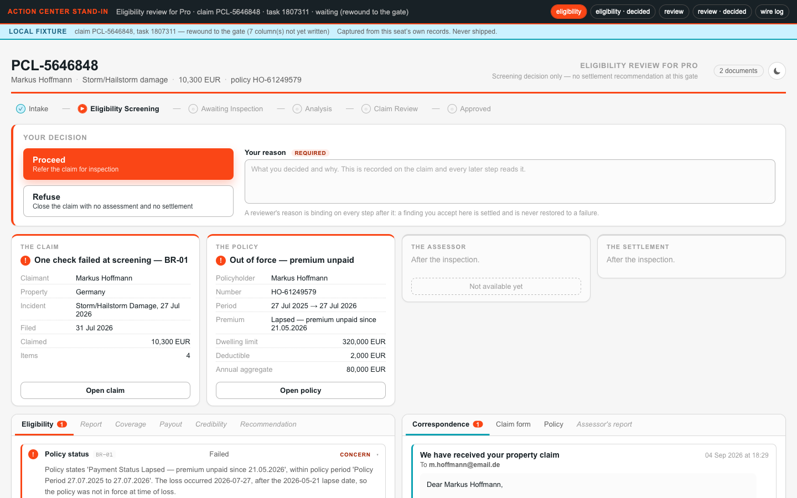{ .screenshot width="900" }

=== "eligibility · decided"

    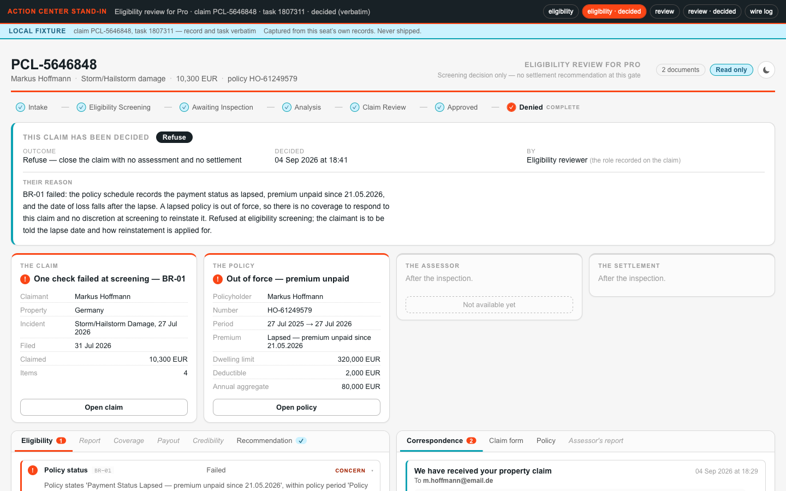{ .screenshot width="900" }

=== "review · open"

    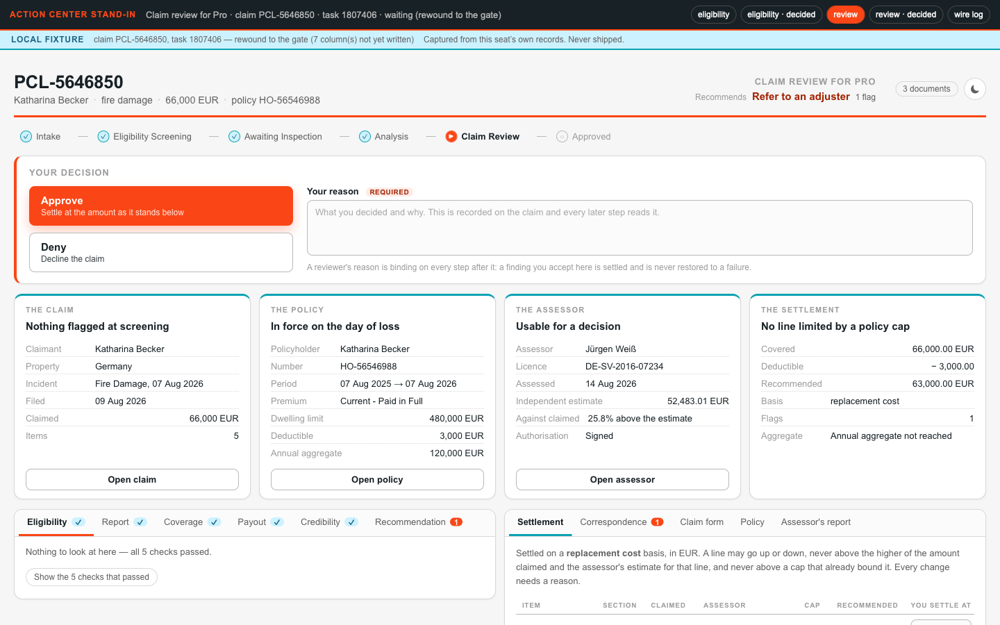{ .screenshot width="900" }

=== "review · decided"

    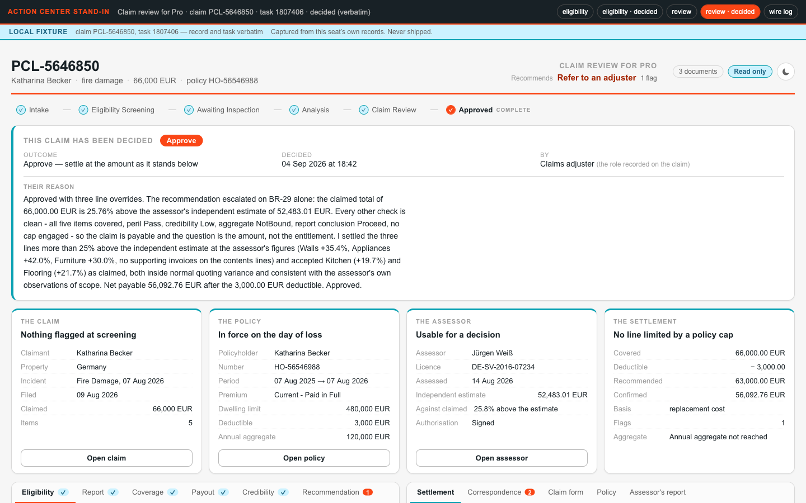{ .screenshot width="900" }

## What the agent will review

- **A decision carries a reason, always.** The contract makes `reviewerNotes` required at both gates, because an inspected **decision with a reason teaches the system** which pattern failed; "a rubber-stamped click is theater" (*The Work That Remains*). If the screen makes the reason easy to skip, it built the wrong habit.
- **One malformed field must not take down the screen.** Generated data varies. Pin shapes upstream where you can, but handle unexpected data in each panel so a "blank page" becomes one panel saying *"could not render the policy"* with the **decision still makeable**. 
- **What survives task completion.** Completing a task in Action Center drops its inputs; only inOuts and outputs survive. That is why the app reads the claim from the Data Fabric entity, not from its input arguments: it still renders after the task is completed.
- **Text a person reads is plain.** The screen shows agent reasons as the agent wrote them; the agents' house style (no field names, no JSON, no em dashes) is what makes that readable.

## The gate

Your reviewer approving all four localhost states is the first gate. After the one publish, the write-back proof is the second: **a fresh claim per gateway**, its task completed from the CLI, the decision read back from the record. A task decided before a fix proves nothing, so always prove against a fresh one. Clicking through the deployed screens in Action Center is your third check, described next.

## In Action Center, after the publish (by you)

The CLI proof shows the case and the record agree; it never opens the screen. Only a signed-in person proves the deployed app in its real host: the sign-in through the shared registration, the PDF viewer in a production build (it can render locally and fail deployed), and the controls sending what the reviewer chose. Find it now, because Verify decides every task from the command line, and a screen fault found after it costs a republish while every task decided meanwhile stays as it was written.

Ask your agent to leave **one fresh claim waiting at each gate** for you, then open each task from Action Center:

| Check | What you should see |
|---|---|
| Open the eligibility task | The claim and its five checks load signed in, with no error panel; both PDFs open |
| Decide it with a reason | The task moves to *Completed*; ask your agent to read the record back, and it carries your outcome and your words |
| Open the claim review task, change one settlement line with its reason, approve | The record's confirmed settlement carries your figure and reason, and the claimant's letter states the amount you approved |
| Reopen both completed tasks | Each still names its claim and shows the decision that was made, read-only |

A check that fails goes back to the agent with what you saw; it is a screen defect, fixed in this block, before Verify starts.

### What each check traces back to

Every panel on the screen exists because a requirement asked for it. Read a screen the way the chain runs: what the PDD requires, how your `sdd.md` pinned it, what the agent built from that. Here is that chain on a real run's deployed screens:

=== "Eligibility checks"

    - **The PDD requires:** at H1 the reviewer sees *"all five screening checks with their results and reasons, passes included… Not a summary"* (`PDD.md` §5.7). BR-01 fails when the premium is unpaid from a date before the loss; BR-04's period includes its last day.
    - **The SDD defined:** EligibilityScreening returns `out_EligibilityChecksJSON`, exactly five entries in rule order, each with `rule`, `check`, `evidence`, `result` and `reason`; the case opens H1 only when one is not a plain `Pass`.
    - **The agent built:** the failure open at the top with its rule and the evidence it quotes, the four passes collapsed to a count, and the count of concerns on the tab (`3f-validation/layout.md`, *the checks*). Check that a failure explains itself from its own evidence, and that a loss on the policy's last day passes.

    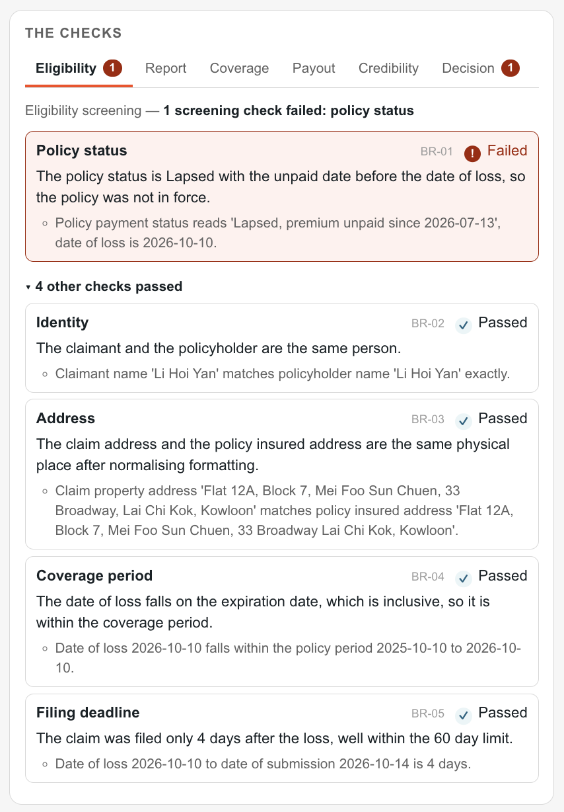{ .screenshot }

=== "Payout checks"

    - **The PDD requires:** BR-29 compares the claimed **total** with the assessor's total and flags more than 20 % above it, never single items; BR-31 notes the ratio and leaves the finding to BR-29.
    - **The SDD defined:** the settlement's own checks in `out_PayoutChecksJSON` (`basis`, `reasonableness` with both totals and the ratio, `aggregate`, `outstanding`), with the arithmetic recomputed by the case from the agent's lines.
    - **The agent built:** one flag naming the rule, both totals and the ratio, the other checks collapsed, and the notes the calculation left for the adjuster, each sublimit that reduced a line. Check that the flag quotes both totals, and that anything the agent could not decide is written as a question for the adjuster, not settled silently.

    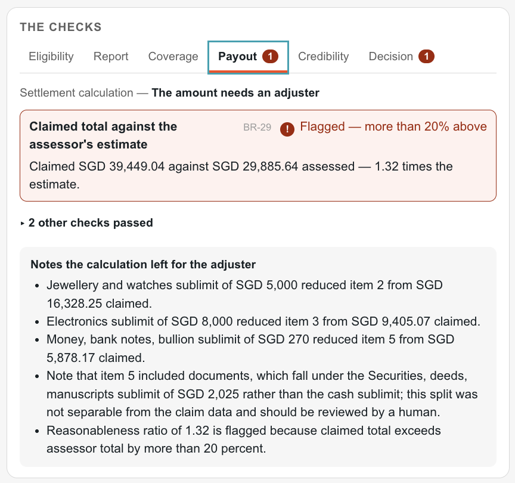{ .screenshot }

=== "Settlement adjustment"

    - **The PDD requires:** at H2 the adjuster may change *"any settlement line, up or down, within BR-61. Every change carries a reason"* (§5.7); the recommendation is never mutated (BR-60); a line cannot go above the higher of claimed and assessed, or its cap (BR-61); an override without a reason is not accepted (BR-62).
    - **The SDD defined:** the adjuster's confirmed settlement comes back as `settlementJson`: `recommendedNetPayable`, `netPayable` and one `overrides` entry per changed line with `original`, `new` and `reason`.
    - **The agent built:** *Recommended* and *Confirmed* side by side, the changed line marked with its reason in the adjuster's words, each cap that bound a line named, the deductible taken once, and both net figures at the bottom. Check that the recommended column did not move, and that the confirmed net is what the letter states.

    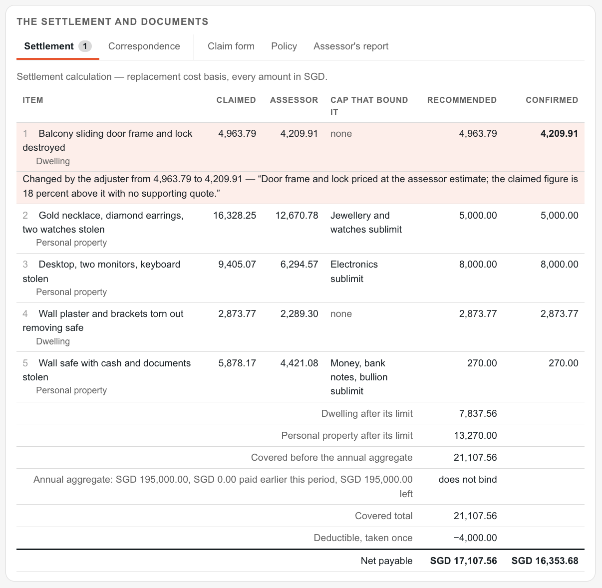{ .screenshot width="900" }

=== "Decided claim"

    - **The spec requires:** completing a task drops its inputs; only `inOuts` and `outputs` survive, so a decided task must still find its claim (`contracts/review-task.md`). A decided screen says so at the top and names who decided: *"outcome, timestamp, person, reason, no controls"* (`layout.md`).
    - **The SDD defined:** the record's `decisionJson.outcome` carries the outcome, `decidedAt`, the reason and `decidedBy`, and this run's SDD wrote `decidedBy` as the role, `"Claims adjuster"`.
    - **The agent built:** the claim reopened from *Completed*, every stage ticked, the decision with its time and reason, no controls, and a plain note that *the claim record names the role, not the person*. The screen is honest about a gap the SDD created: the layout asks for the person. Check that a completed task opens, and look at who it says decided.

    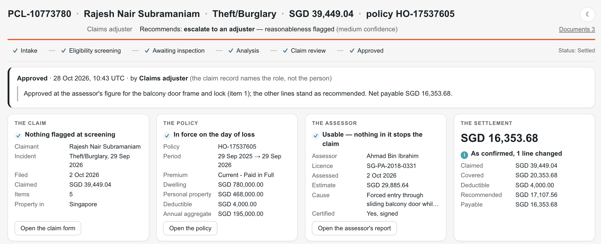{ .screenshot width="900" }

=== "Correspondence"

    - **The PDD requires:** the adjuster sees *"every letter already sent to the claimant"* (§5.7); the claimant is written to exactly twice, received and outcome (BR-50); the letter explains the outcome and never re-opens it (BR-52).
    - **The SDD defined:** the tenant-level `ClaimCorrespondence` entity as the letters as sent, one row per letter, two per claim, joined to the claim by `claimId`.
    - **The agent built:** the thread in the order sent, with date, recipient, subject carrying the claim number, and body, and the count on the tab (`layout.md`, *correspondence*). Check that there are exactly two letters, and that the outcome letter gives the reason a person ruled on.

    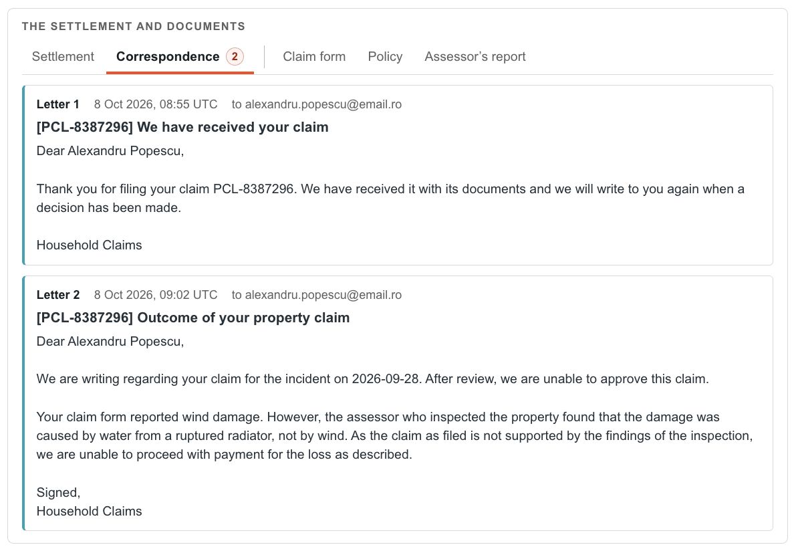{ .screenshot width="900" }

## Proof

<!-- screenshot: the claim review screen in Action Center — findings side by side, settlement lines, the two outcome buttons -->

Both gates render in a browser on real data, and a decision, with its reason, lands on the claim record and moves the case on.

## One layout, four different screens

The regions are fixed by `layout.md` and the look by `brand.md`, and still different models hand back visibly different screens from the same prompt, the same layout contract and the same data shapes. The first tab is the contract itself: the wireframe every build had to honour. Then come four builds of this very app:

=== "The spec"

    From `3f-validation/layout.md`, the H2 wireframe with its regions fixed and the styling free:

    ```text
    --8<-- "seeds/3f-validation/layout.md:27:52"
    ```

=== "Sonnet 5"

    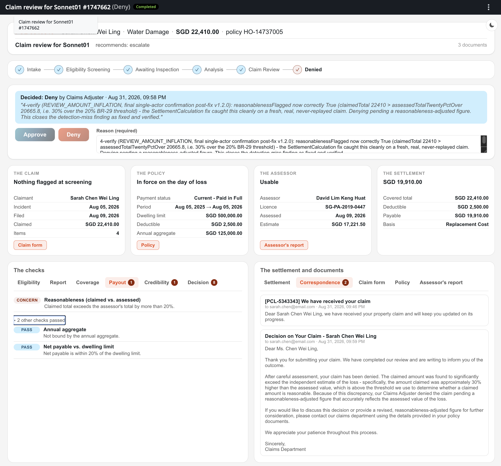{ .screenshot width="900" }

=== "Opus 5"

    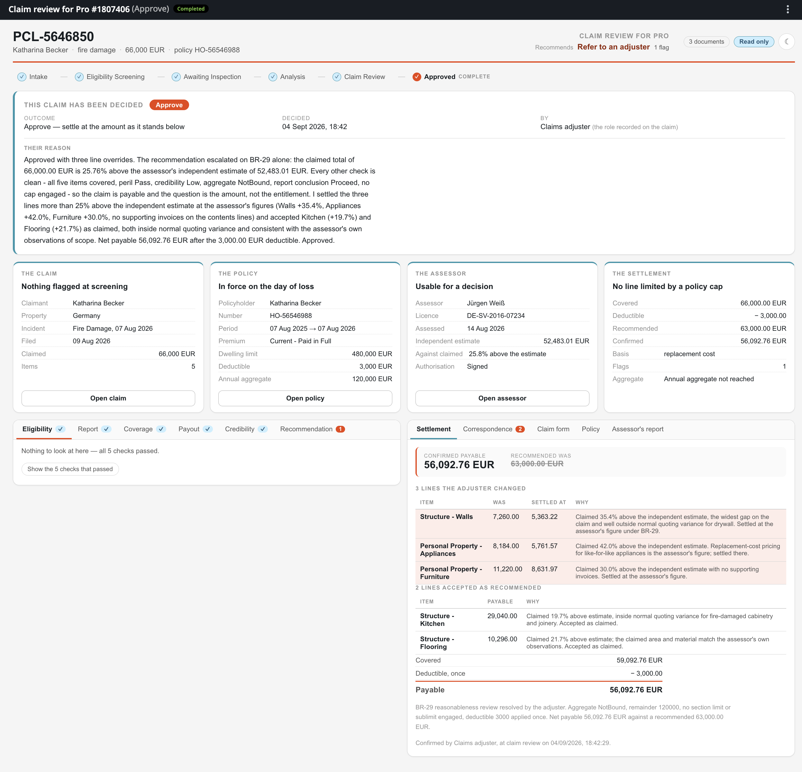{ .screenshot width="900" }

=== "GPT-5.5"

    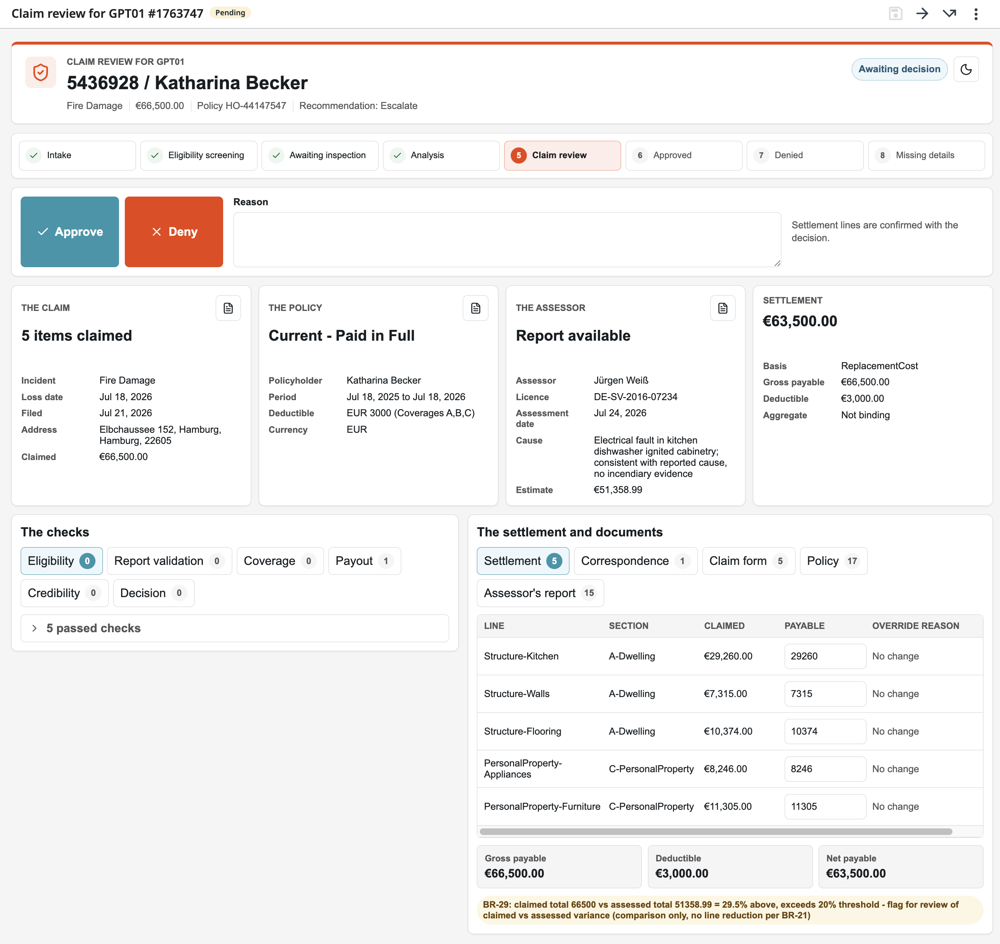{ .screenshot width="900" }

=== "GPT-5.6 Terra"

    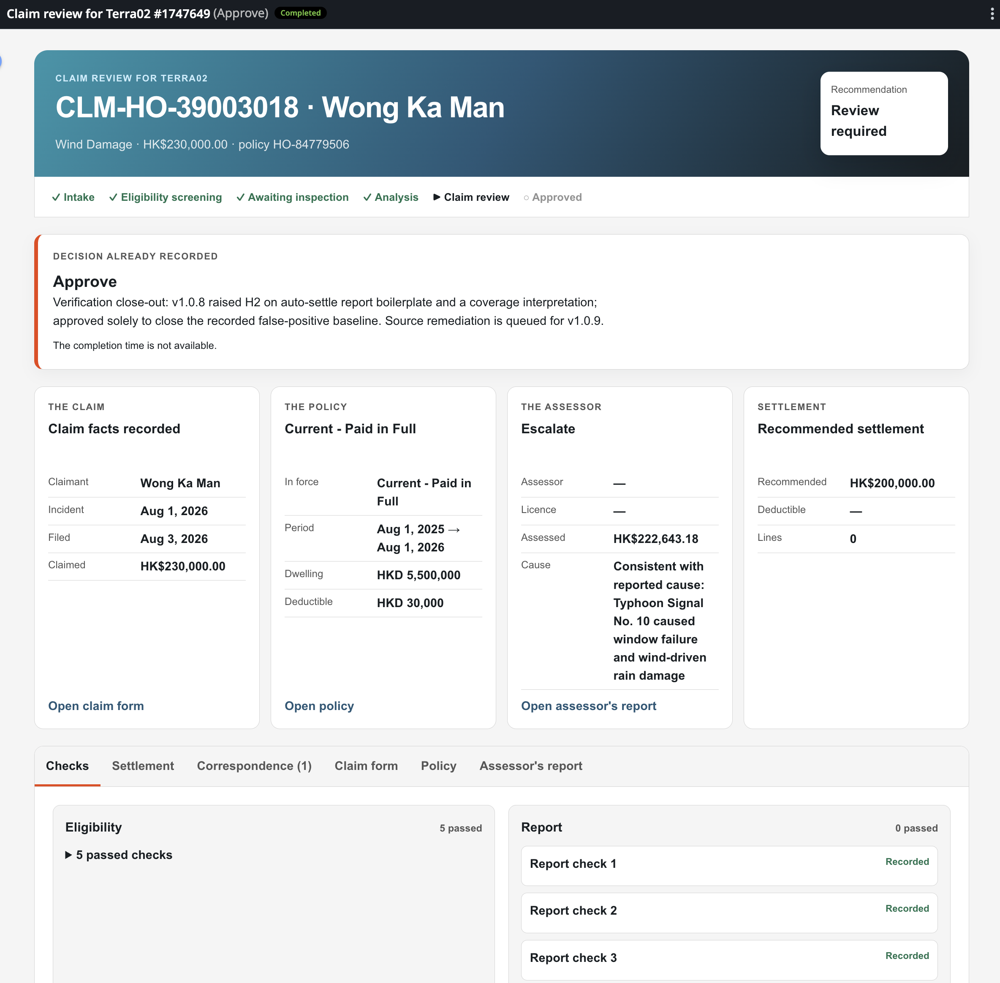{ .screenshot width="900" }

The layout contract fixes the regions and leaves the styling open, so each model styles the screens its own way. The localhost pause is where you review that styling before it ships.

---

!!!note "Could this block have run in parallel with the previous one?" 
	In this course we go step by step, because we're here to learn, not to race. In real life, independent builds can run in parallel.
	
	The block that tests the case plan and this one, which builds the Coded App, barely overlap:
	
	- The run block **redeploys the solution**, while this block redeploys **the app alone**
	- The contract for both was pinned back at registration
	- The run block completes its tasks from the command line and never waits for an Action App.
	 
	 However, the app screens are built against payloads real runs produced, and the first fully populated record exists as soon as the clean claim has settled: fork there.

