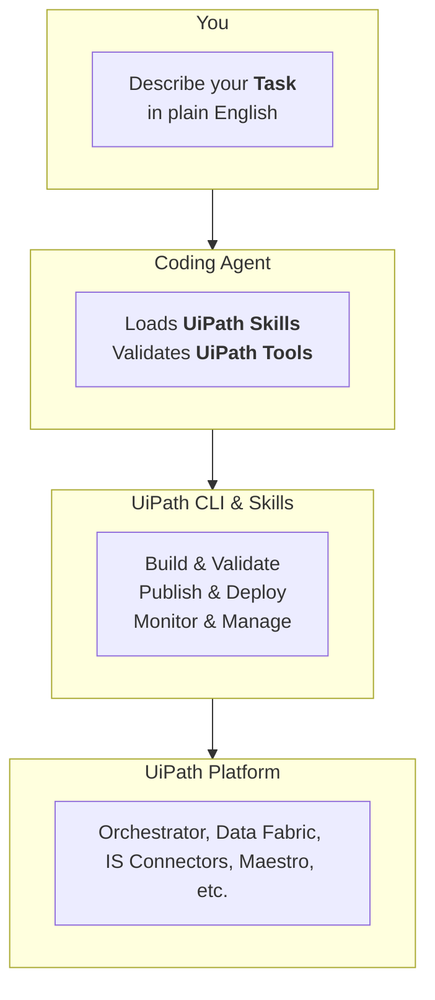
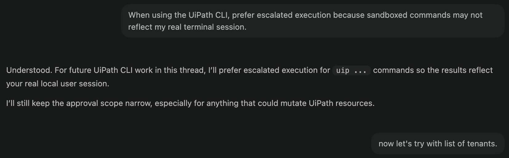

# Prepare Your Tools

!!! tip "Here is our plan for this lesson:"

    1. Check what you already have: CLI, sign-in, skills.
    2. Install whatever is missing.
    3. Verify that your agent recognizes UiPath tasks.

## Goal

A working setup before the exercise starts: the latest `uip` CLI installed and authenticated, the UiPath skills added to your coding agent, and one quick check that proves the agent knows how to build with UiPath. If you have done a UiPath coding-agents session before, this page is a five-minute checkup.

## Which coding agent to bring

Any coding agent that runs shell commands can do this exercise; the workshop environment comes with one. If you have your own, bring it. In our full test builds, **Claude Code with Opus 5.5** finished with fewer repair cycles and a cleaner result than the other agents we tried: the same planted problems caught, and no clean claim sent to a person for no reason.

| | What it changes for you |
|---|---|
| Quality | The fewer repair cycles, the more of the afternoon goes on the parts that teach something: the case, the review screens, Verify |
| Speed | Mostly decided by your machine: a sandbox that blocks the CLI or a Windows console that cannot print UTF-8 costs more time than the model does. Step 5 below removes both |
| Your own agent | Same seed, same steps. Install the skills for it in step 4 and set up its shell in step 5 |

## What the agent needs to build on UiPath

A coding agent already knows how to write code, out of the box. What it doesn't know is the UiPath platform: its CLI commands, components, code structures and conventions. 

[[[
Two pieces fix that:

- **UiPath CLI** (`uip`) is the interface the agent uses to talk to the platform. A command-line interface turned out to be the most token-efficient way to expose UiPath to an agent.
- **Skills** teach the agent to use that CLI well. Each one packs product context, commands, validation rules and best practices, so you can ask for an outcome instead of memorizing command sequences.
- Together with your session and permissions, this wrapper around the agent is the **harness**: the controlled environment of context, tools and checkpoints an agent works inside. You are about to assemble one.
|50|

]]]

## Steps

### 1. Check what you have

```bash
uip --version
uip login status
uip tools list
uip skills list
```

If all four answer sensibly, run the three `uip config`/`uip update` lines from step 2, then skip to step 5. Otherwise, do only the steps you're missing.

### 2. Install the UiPath CLI

Install the CLI globally. This gives you the `uip` command.

```bash
npm install -g @uipath/cli
```

Then point it at the preview line this workshop is built on, and update to its latest version:

```bash
uip config set version 1.205
uip config set updateChannel preview
uip update
```

Already have the CLI? Run these three anyway, so you're on the same line as the seed.

### 3. Sign in

Authenticate once in the browser. Your coding agent reuses this same session, so it acts as you on the platform.

```bash
uip login
```

### 4. Install the UiPath skills

`uip skills install` adds the skills to the agent you name:

=== "Claude Code"

    ```bash
    uip skills install --agent claude
    ```

    Skills install globally for Claude Code (the `--local` flag is for other agents). Restart Claude Code afterwards so it reloads plugins.

=== "Codex"

    ```bash
    uip skills install --agent codex
    ```

=== "OpenCode"

    ```bash
    uip skills install --agent opencode
    ```

The installer walks you through selecting skill bundles. Pick the ones this workshop uses; the seed's `CONFIG.md` has the exact list.

!!! info "Good to know"
    The skills registry is [public on GitHub](https://github.com/UiPath/skills), so this step needs no login. You don't need to install platform tools first either: your agent installs them on first use.

A few commands to keep handy:

```bash
uip login status
uip --version
uip update
uip tools update
uip skills update
```

`uip update` updates the tools and refreshes the installed skills too. Run it between blocks, never while your agent is working.

`uip --help` and `uip <command> --help` are your best friends, right after your coding agent.

### 5. Set up your agent's shell

Do this before block 1. An agent that cannot run `uip` the way your terminal does loses its sign-in half-way through a block, and the error says *refresh token invalid* although your login is fine.

=== "Claude Code"

    Claude Code can sandbox its shell. Exclude `uip` from the sandbox, in your seat folder's `.claude/settings.local.json`:

    ```json
    {
      "sandbox": { "excludedCommands": ["uip"] }
    }
    ```

    The agent should call `uip` directly: a script that calls `uip` for it still runs inside the sandbox.

=== "Codex"

    With full access (`sandbox_mode: danger-full-access`) Codex runs `uip` as your terminal does, and nothing else is needed. In a sandboxed mode, tell it once, at the start: *"When using the UiPath CLI, prefer escalated execution because sandboxed commands may not reflect my real terminal session."*

    On Windows, the agent runs Python as `python -X utf8`, writes JSON files with Python rather than PowerShell, and starts dev servers with `npm.cmd`. The seed's `CONFIG.md`, *Windows*, has the full list; the agent reads it, but it helps to know why the first block's commands look the way they do.

=== "OpenCode"

    If your setup sandboxes commands, let `uip` run outside the sandbox, the same way as for the other agents. On Windows, the same notes as under Codex apply.

Also keep port **5173** free on your machine: it is the only local sign-in address the workshop's apps are registered for (block 6).

### 6. Verify the setup

Run your agent with the skills installed and ask it for an outcome, not a command:

```text
which uipath skills I can use? can you list tenants within environments I'm connected to?
```

[[[
A correctly set-up agent will use the tools and give you the answer. If it doesn't recognize UiPath tasks, restart your coding agent once so it reloads plugins.
|30|
{ .screenshot }
]]]

## Identity and permissions

!!! info "Sessions, security, and what the agent may do"
    Everything the agent does goes through the `uip` CLI, and the CLI is signed in as exactly one identity: **yours**. It cannot reach anything your account cannot reach, and no setting makes it safer than your account. Three habits follow:

    - **Approve commands as they come, and allow the build loop once.** Avoid a blanket `uip` allow rule, since it also covers destructive commands. Read/list prefixes are fine to approve permanently. Before block 3, allow the loop your agent repeats in every block (pack, publish, deploy, upload) and edits to your seat's own `caseplan.case` and `sdd.md`. An agent's safety check can refuse a plain edit of its own case file mid-block, and a block that stops to ask proves nothing.
    - **Keep secrets out of prompts and project files.** Credentials belong in a secret store, never in the conversation.
    - **Review before you deploy.** A coding agent does not validate the compliance of generated code; that stays your job.

    Some agents run commands in isolated environments and may not see your real session. If `uip login status` works in your terminal but the agent says otherwise, its sandbox is in the way: step 5.

## Read more

| Official page | What it covers |
|---|---|
| [Coding agents overview](https://docs.uipath.com/coding-agents/standalone/latest/user-guide/overview) | The mental model: agent + CLI + skills |
| [Working effectively](https://docs.uipath.com/coding-agents/standalone/latest/user-guide/working-effectively) | Best practices for driving an agent on UiPath |
| [Governance and trust](https://docs.uipath.com/coding-agents/standalone/latest/user-guide/governance-and-trust) | Identity, permissions, telemetry |
| [Managing tools and skills](https://docs.uipath.com/uipath-cli/standalone/latest/user-guide/managing-tools-and-skills) | Install, update and pin skills per agent |

Done. Your tools are ready.
